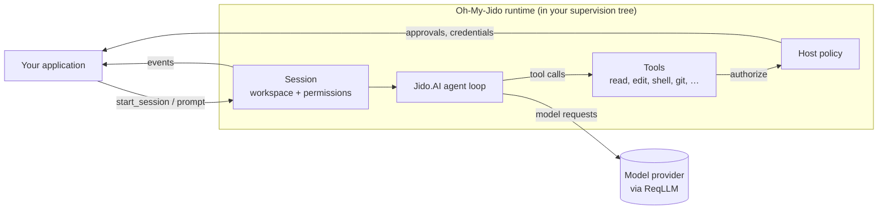

# Oh-My-Jido

**A coding agent you embed in your Elixir application.**

Oh-My-Jido gives an Elixir or Phoenix application the abilities of a coding agent such as Claude Code or Codex. It can explore a repository, make careful edits, run tests and commands, use Git, refactor Elixir code, query language servers and debuggers, and hand subtasks to sub-agents. It runs as an ordinary OTP library inside your supervision tree, built on [Jido](https://github.com/agentjido/jido), [Jido.AI](https://github.com/agentjido/jido_ai) and [ReqLLM](https://github.com/agentjido/req_llm).

Use it to build features such as an in-app documentation editor that proposes, checks and publishes its own changes, a service that repairs failing tests in a disposable checkout, or an internal tool that answers questions about your codebase.

Your application stays in charge. It decides which directory the agent works in, which tools and permissions each session gets, which model and account pay for inference, and which actions need a human's approval.

> **This is the `jido-v3-preview` branch.** It runs the same library on the Jido 3.0 beta stack: Jido 3.0.0-beta.1, Jido.Action 3.0.0-beta.12, Jido.AI with native Jido 3 support (its upstream version metadata still reads 2.3.0) and ReqLLM 1.28.0. For the stable Jido 2.4 stack, use [`master`](https://github.com/mattneel/oh_my_jido).
>
> **Status:** pre-release (0.1.0), not yet on Hex. Install from GitHub. Tested on Linux x86_64 with Elixir 1.20 and OTP 28. See [project status](docs/project-status.md).

## Why Oh-My-Jido

- **Embedded, not bolted on.** There is no CLI, daemon or Node/Bun sidecar. Sessions are supervised processes in your application, and nothing starts until your code opens one.
- **Real coding tools.** Exact reads, snapshot-checked edits that never overwrite newer changes, commands with explicit arguments and timeouts, Git, structural Elixir refactoring, LSP, debuggers, sub-agents and persistent Elixir/JavaScript/Python evaluation.
- **You control authority.** Sessions start with no permissions. Sensitive actions pause for approval through your UI. Model credentials come from your code for each model request, never from the prompt or the session.
- **Durable and honest about side effects.** With file storage, sessions checkpoint and restore after restarts. Every tool call is journaled; if a crash interrupts one, it is marked *uncertain* and never silently run again.
- **Built for user interfaces.** Ordered, typed events report model output, tool progress, questions and approval requests, ready for a Phoenix LiveView or any process.
- **Your choice of model.** Any provider ReqLLM supports (Anthropic, OpenAI, OpenRouter and more), with a different model per role, plus OpenAI "Sign in with ChatGPT" accounts and delegation to the official Claude Code CLI.

## What the agent can do

| Area | Capabilities | Tools |
|---|---|---|
| Explore | Read files exactly, list files and search text with ripgrep | `read`, `list`, `search` |
| Edit | Atomic writes and exact replacements checked against a snapshot of the file | `write`, `edit` |
| Run | Execute commands and tests with explicit arguments, scoped environment, timeouts and process cleanup | `shell` |
| Version control | Status, diff, log, commits of chosen paths, isolated worktrees | `git` |
| Understand code | Structural Elixir search and replace, language-server diagnostics, navigation and rename, step debugging | `ast`, `lsp`, `debug` |
| Inspect live apps | Processes, supervision trees and ETS metadata of a running BEAM node; optional Tidewave tools | `observer`, `mcp` |
| Evaluate | Persistent Elixir, JavaScript and Python cells in separate runtimes | `eval` |
| Collaborate | Sub-agents, questions to a human, plans and goals with verified checks, memory, measured experiments | `subagent`, `question`, `goal`, `memory`, `experiment` |
| Extend | Your own Jido Actions, approved skills, MCP servers, browser and research services, Claude Code delegation | `skill`, `mcp`, `browser`, `research`, `claude_code`, … |

See the [tool guide](docs/guides/tools.md) for the complete catalog.

## How it works



Each **session** is a Jido agent bound to one workspace directory. When you submit a task, Jido.AI runs a reasoning loop: the model proposes a tool call, Oh-My-Jido checks it against the session's permissions and your policy, runs it, records it in a durable journal and streams events back to you. The loop continues until the model answers. Read [concepts](docs/concepts.md) for the full picture.

## Quick start

These steps were tested in a new application created with `mix new my_app --sup`. Steps 1–3 need no model credentials.

### 1. Add the dependency

```elixir
# mix.exs
defp deps do
  omj = [github: "mattneel/oh_my_jido", branch: "jido-v3-preview"]

  [
    {:oh_my_jido, omj},
    # The preview ships patched Jido 3 snapshots that keep credentials out of
    # logs. They must override every other source of these packages.
    {:jido, omj ++ [sparse: "vendor/jido", override: true]},
    {:jido_ai, omj ++ [sparse: "vendor/jido_ai", override: true]},
    {:jido_action, omj ++ [sparse: "vendor/jido_action", override: true]},
    {:req_llm, omj ++ [sparse: "vendor/req_llm", override: true]},
    {:jido_signal,
     git: "https://github.com/agentjido/jido_signal.git",
     ref: "fd8d00555d6a64b4109619f4c26f1b75e8a91d41",
     override: true},
    {:zoi,
     git: "https://github.com/mikehostetler/zoi.git",
     ref: "2fff2a23e23e7ac0b26f62f49bbc1b12f7818ac9",
     override: true}
  ]
end
```

Run `mix deps.get`. To use a local checkout instead, see [getting started](docs/getting-started.md#from-a-local-checkout).

### 2. Start a runtime

Add a runtime to your application's supervision tree. It starts no sessions and makes no model requests.

```elixir
# lib/my_app/application.ex
children = [
  {OhMyJido, name: MyApp.Coding}
]
```

### 3. Open a session and call a tool yourself

Start `iex -S mix`, then:

```elixir
{:ok, session} =
  OhMyJido.start_session(MyApp.Coding,
    workspace: "/path/to/your/project",
    permissions: [:read]
  )

{:ok, file} = OhMyJido.execute_tool(session, "read", %{path: "mix.exs"})
IO.puts(file.content)
```

The session can read files inside the workspace and nothing else. A write returns an error whose reason is `{:permission_denied, :edit}` until you grant `:edit`.

### 4. Give the agent a task

Tell Oh-My-Jido where model credentials come from. Your resolver is called before each model request with the session's account:

```elixir
# lib/my_app/model_credentials.ex
defmodule MyApp.ModelCredentials do
  def resolve(_context, "anthropic", _options) do
    {:ok, [api_key: System.fetch_env!("ANTHROPIC_API_KEY")]}
  end

  def resolve(_context, _account, _options), do: {:error, :unknown_account}
end
```

```elixir
# lib/my_app/application.ex
children = [
  {OhMyJido, name: MyApp.Coding, credentials: {MyApp.ModelCredentials, []}}
]
```

Restart `iex -S mix`, then open a session with a model and an account, and submit a task:

```elixir
{:ok, session} =
  OhMyJido.start_session(MyApp.Coding,
    workspace: "/path/to/your/project",
    permissions: [:read],
    model: "anthropic:claude-sonnet-4-6",
    account: "anthropic"
  )

:ok = OhMyJido.subscribe(session, self())
{:ok, run_id} = OhMyJido.prompt(session, "How are this project's tests organized?")
{:ok, result} = OhMyJido.await(session, run_id, timeout: 120_000)
IO.puts(result.answer)
```

While the task runs, your process receives `{:oh_my_jido, %OhMyJido.Event{}}` messages: `:llm_delta` for model output, `:tool_started` and `:tool_completed` for tool calls, `:approval_requested` when a human must decide, and `:run_completed` at the end.

To let the agent change code and run tests, grant `:edit` and `:exec`. Approve or deny a sensitive action with `OhMyJido.answer(session, question_id, :approve)`. [Getting started](docs/getting-started.md) walks through approvals, events and durable sessions.

## Choose how much to embed

| You want | Use | You get |
|---|---|---|
| Individual tools in your own code | `OhMyJido.Context` with `Jido.Exec` | Workspace- and permission-checked tools; no agent loop |
| Coding tools on a Jido agent you already have | `OhMyJido.Plugin` | Your agent, your model policy, Oh-My-Jido's tools |
| A managed coding agent | `{OhMyJido, name: MyApp.Coding}` | Sessions, events, approvals, journal, checkpoints, sub-agents |

The first two are covered in [Jido agents and standalone tools](docs/guides/jido-agents.md); the third in [running tasks](docs/guides/running-tasks.md).

## Safety model

- **No permissions by default.** You grant capabilities such as `:read`, `:edit`, `:exec` and `:git` per session. Making a tool available never grants its permission.
- **Workspace confinement.** File paths are resolved inside the workspace, with traversal and symlink checks.
- **Conflict-safe edits.** Edits are checked against a snapshot of the file; a stale snapshot is refused instead of overwriting newer changes.
- **Explicit commands.** Shell runs an executable with an argument list, in the workspace, with a deadline and process-group cleanup. It does not parse command strings.
- **Human approval.** Sensitive actions such as commits, applied renames and external requests wait for an approval from your UI. A stricter policy can require approval for every command.
- **Credentials stay out of the conversation.** Your resolver supplies them for each model request; they never enter prompts, sessions or checkpoints.
- **No blind retries.** Interrupted side effects are marked uncertain and are never retried automatically.
- **Not an OS sandbox.** Shells, builds and language servers run real code as your OS user. Use containers, separate users and network policy for untrusted repositories. See [security](docs/guides/security.md).

## Examples

- [Plain Mix application](examples/plain_mix/README.md): an ordinary Mix application that supervises Oh-My-Jido, repairs a failing test, steers and cancels work, and restores sessions after a restart.
- [Your own Jido agents](examples/jido_agent/README.md): coding tools on a plain Jido agent and on a Jido.AI agent, using the Jido 3 agent DSL.
- [Docs site and studio](examples/docs_site/README.md): a Phoenix documentation site whose private studio uses Oh-My-Jido to edit its own Markdown and source, with diffs, checks, preview and approval before publishing. It is the basis for the Oh-My-Jido documentation site.

## Documentation

| Start here | |
|---|---|
| [Getting started](docs/getting-started.md) | Install, first tool call, first AI task, events, approvals and durable sessions |
| [Concepts](docs/concepts.md) | Runtimes, sessions, runs, permissions, policies, events and the effect journal |
| [Guides](docs/README.md#guides) | Tasks, tools, permissions, models, recovery, sub-agents, language tools, live apps, Eval, integrations, security |
| [Reference](docs/README.md#reference) | Public API and configuration |
| [Operations](docs/operations.md) | Storage, telemetry, capacity and platform requirements for production |

The [documentation map](docs/README.md) lists every page.

## Requirements

- Elixir `~> 1.20` (tested with 1.20.2 on OTP 28).
- Tools that start OS processes (List, Search, Shell, Git, Claude Code, language servers, debuggers, MCP servers and Eval) need Linux with `setsid` and `/proc`. Elsewhere they fail closed with `{:capability_unavailable, :linux_process_groups}`, `:protocol_platform_unavailable` or `{:backend_unavailable, …}`. Other operating systems are untested; Read, Write, Edit, AST, Observer and the model loop do not start OS processes.
- `rg` (ripgrep) for the list and search tools, and `git` for the Git tools.
- Optional: a language server such as ElixirLS, a debug adapter such as GDB, and QuickBEAM or Snakepit for JavaScript or Python Eval.

## Project status

Oh-My-Jido 0.1.0 is pre-release software and its API may change. Two branches are maintained:

- [`master`](https://github.com/mattneel/oh_my_jido) uses the stable Jido 2.4 stack.
- `jido-v3-preview` (this branch) carries the same library and examples on the Jido 3.0 beta stack. The vendored snapshots' `vendor/*/UPSTREAM.json` manifests record their exact upstream revisions and privacy patches; no package version is relabelled.

[Project status](docs/project-status.md) explains what is verified, on which platform, and where the evidence lives. The [changelog](CHANGELOG.md) lists unreleased changes.

## Development

```sh
mix deps.get
mix ci     # compile with warnings as errors, format check, tests, Credo, Dialyzer, ExDNA, Reach
mix docs   # API reference and guides in doc/
```

The project's specification, delivery ledger and verification records live in [`docs/oh-my-jido/`](docs/oh-my-jido/README.md).

## License

Oh-My-Jido is licensed under the [Apache License 2.0](LICENSE). The vendored Jido, Jido.AI, Jido.Action and ReqLLM snapshots keep their Apache-2.0 licenses, and the vendored Snakepit snapshot keeps its MIT license.
