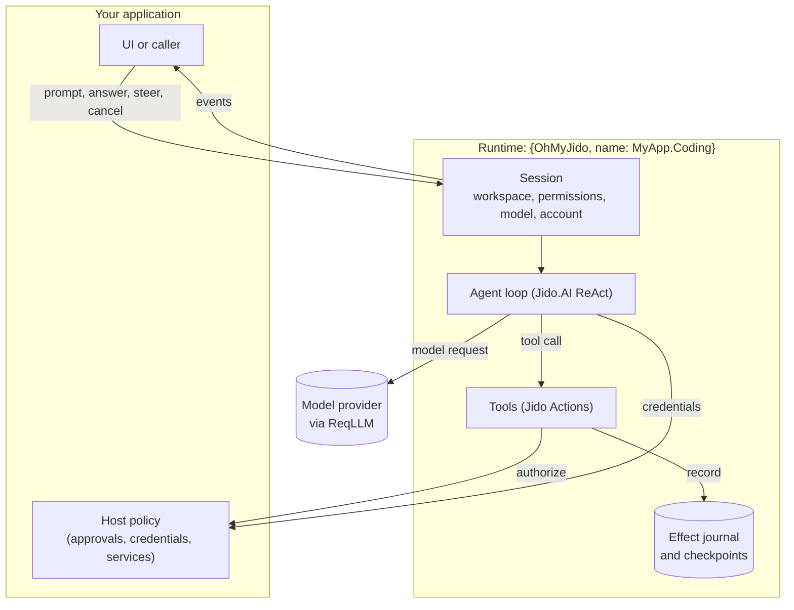

# Concepts

This page explains the pieces you work with in Oh-My-Jido and how they fit together. Read it once before the guides; each guide assumes these terms.

## The big picture

Oh-My-Jido is built from three existing libraries. [Jido](https://github.com/agentjido/jido) provides agents as supervised OTP processes. [Jido.AI](https://github.com/agentjido/jido_ai) runs the model-and-tool loop on those agents. [ReqLLM](https://github.com/agentjido/req_llm) talks to model providers. Oh-My-Jido adds the coding tools, sessions, permissions, approvals, durable journal and recovery around them. When these docs call something *native*, they mean it comes from Jido, Jido.AI or ReqLLM themselves rather than from Oh-My-Jido.

## Runtime

A **runtime** is a named Oh-My-Jido instance that you place in your supervision tree with `{OhMyJido, name: MyApp.Coding}`. It holds configuration shared by its sessions: the host policy, the credentials resolver, storage, tool availability, model roles and capacity limits.

Starting a runtime starts only its own supervision tree. No session opens, no model is called and no external service starts until your code asks. You can run several runtimes side by side with different policies, credentials, storage and limits. Each has its own Jido instance, session registry and Eval manager; application-wide settings such as Jido model aliases and ReqLLM provider registration are shared.

## Session

A **session** is one coding agent bound to one existing directory, its **workspace**. It has:

- a set of **permissions**, empty by default;
- the **tools** available to it;
- a selected **role**, **model** and **account** for model requests;
- a conversation, retained task facts, a plan and an effect journal.

You create one with `OhMyJido.start_session/2` and refer to it by `%OhMyJido.SessionRef{runtime: MyApp.Coding, id: id}`. The ID is durable: with durable storage you can stop a session and resume it later, even after restarting your application. Process IDs are never the handle.

A session runs one task at a time.

## Run

A **run** is one task submitted with `OhMyJido.prompt/3`. It returns a run ID immediately; `OhMyJido.await/3` waits for the result. A run ends with one of these statuses:

| Status | Meaning |
|---|---|
| `:completed` | The model produced a final answer. Tools may still have failed along the way; check the run record. |
| `:failed` | The run stopped with an error, such as a missing account or a provider failure. |
| `:cancelled` | Your application cancelled it with `cancel/2`. |
| `:suspended` | Your application suspended it with `suspend/2`; call `resume/1` before the next task. |
| `:timed_out` | It exceeded the runtime's run deadline. |
| `:interrupted` | The session restarted while the run was active. |

While a run is active you can add guidance with `steer/3`, or stop it with `cancel/2` or `suspend/2`. Stopping a run never undoes changes it already made.

## The agent loop

Inside a run, Jido.AI uses a **ReAct** loop: the model reads the conversation and the available tool descriptions, then either answers or asks to call a tool. Oh-My-Jido checks and runs each tool call, returns the result to the model, and repeats until the model answers or the iteration limit is reached.

Long tasks are kept within the model's context by **ContextPolicy**. It keeps the goal, constraints, important file facts, memory and unresolved work, plus recent messages, and drops older transcript text. It selects existing content rather than asking another model to summarize it.

## Tools

A **tool** is a [Jido Action](https://github.com/agentjido/jido_action): an Elixir module with a name, an input schema and a `run/2` function. Oh-My-Jido ships tools for files, search, shell, Git, structural Elixir editing, language servers, debuggers, live application inspection, Eval, sub-agents, questions, plans and more. You can add your own Actions.

Two separate settings control whether a tool can do something:

1. **Availability.** Which tools a session has. Choose them with named **bundles**, such as `bundles: [:read_only, :editing]`, or an explicit `tools:` list. The model only sees available tools.
2. **Permission.** What the session may do. For example, the `write` tool needs the `:edit` permission and the `shell` tool needs `:exec`. A tool that is available but not permitted fails before it does anything.

Making a tool available never grants its permission. You can also call any available tool yourself with `OhMyJido.execute_tool/4`; it goes through the same checks and the same journal as a call from the model. Each tool call is recorded as one **effect**; a single tool may still ask for approval of individual steps, such as staging and then committing.

## Permissions

Permissions are atoms you pass as `permissions:`. Common ones:

| Permission | Allows |
|---|---|
| `:read` | Reading, listing and searching files in the workspace |
| `:edit` | Creating and changing files |
| `:exec` | Running executables with the shell tool |
| `:git` | Git status, diff, log; commits also need `:edit` |
| `:ask` | Asking a human a clarification question |
| `:delegate` | Starting sub-agents |

Language servers, debuggers, Eval, MCP, browsers and other services each have their own permission. The [permission reference](guides/permissions-and-approvals.md#permission-reference) lists them all.

Permissions come only from your application. Text in a repository, a tool result, a web page or the model's own output can never grant one.

## Host policy and approvals

The **host policy** is a module implementing the `OhMyJido.Host` behaviour. Oh-My-Jido consults it to:

- authorize each effect after the permission check;
- obtain credentials for a model request;
- reach optional services such as a language server or browser;
- ask a human a question.

The default, `OhMyJido.Host.Local`, allows permitted effects and asks for **approval** when an effect is marked sensitive, such as a Git commit, an applied rename, an MCP tool call or a browser action. An approval appears as an `:approval_requested` event. Your interface shows it to a person and calls `OhMyJido.answer/3`. Only `:approve`, `true` or `"approve"` approve; everything else, including no answer, denies.

Write your own host policy when you need different rules, for example approval before every shell command.

## Models, roles and accounts

A **model** is a ReqLLM model string such as `"anthropic:claude-sonnet-4-6"`. A **role** describes the kind of work: `:coding`, `:planning`, `:exploration`, `:review`, `:advisor` or `:compaction`. Each role can use a different model, so exploration can use a fast model and coding a stronger one.

An **account** is an opaque name your application chooses, such as `"anthropic"` or `"team-openai"`. It is never a secret. Before each model request, Oh-My-Jido passes the session's account to your **credentials resolver**, which returns the API key or OAuth token for it. Credentials never enter prompts, sessions or checkpoints, and a failed account never falls back to another account or billing method.

## Events

A process that calls `OhMyJido.subscribe/3` receives messages of the form `{:oh_my_jido, %OhMyJido.Event{}}`. Each event has a `kind` (such as `:llm_delta`, `:tool_started`, `:approval_requested` or `:run_completed`), a `payload`, the `run_id` and an increasing `seq`.

Events are for live progress. Payloads are redacted and size-limited. A session keeps a bounded buffer that `OhMyJido.events/2` can read, and a subscriber whose mailbox grows too large is detached. Use `await/3` for the final result, and store anything you must keep in your own database.

## The effect journal and uncertainty

Every tool call is an **effect**. Before a tool runs, the session records its intent in the **effect journal**; afterwards it records the outcome. This makes recovery honest:

- If a crash interrupts a tool call, the restored session marks it `:uncertain`. Oh-My-Jido cannot know whether a half-finished command already changed something.
- Uncertain effects are **never retried automatically**. Neither are tool calls in general: a failed command is reported, not repeated.
- A journal status of `:completed` means an outcome was recorded, not that it succeeded. The recorded result says whether it did.

After an interruption, inspect the real state of the repository or external system, then decide. [Sessions and recovery](guides/sessions-and-recovery.md) describes the steps.

## Durability

Sessions are stored through a Jido storage adapter. The default ETS adapter lasts as long as the VM; `{Jido.Storage.File, path: dir}` survives restarts. A stored session keeps its identity, workspace, permissions, selected tools, role, model, account, goal, conversation, plan, retained facts, run history and journal. Credentials, service connections, pending questions, subscriptions and process IDs are not stored; credentials and services come from the runtime configuration again on restore.

## Three ways to use Oh-My-Jido

| Level | Entry point | Use it when |
|---|---|---|
| Standalone tools | `OhMyJido.Context` with `Jido.Exec` | Your code decides which operation to run and wants the tools' checks |
| Plugin | `OhMyJido.Plugin` on your own Jido or Jido.AI agent | You already have agents and want to add coding tools to them |
| Managed sessions | `{OhMyJido, name: ...}` and `start_session/2` | You want the complete coding agent: events, approvals, journal, recovery, sub-agents |

[Jido agents and standalone tools](guides/jido-agents.md) covers the first two levels; the rest of the guides cover managed sessions.

## What Oh-My-Jido is not

- **Not a CLI or service.** It is a library; your application decides how people reach it.
- **Not an OS sandbox.** Workspace confinement and permissions are checks inside the library. A shell, compiler, test suite or language server runs real code as your OS user. Isolate untrusted work with containers, users and network policy; see [security](guides/security.md).
- **Not a job queue.** Accepting new work is called *admission*. When a capacity limit is full, admission fails with `{:error, {:capacity, kind}}`; the work is refused, not queued.
- **Not a model provider.** Model access, accounts and billing are yours; ReqLLM sends the requests.
