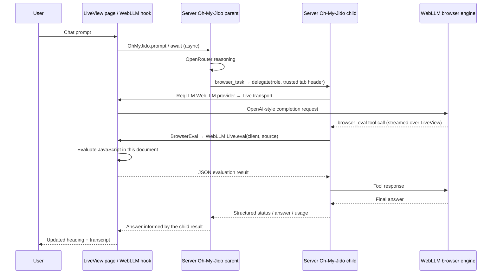

# Server agent, browser GPU

A handwritten Phoenix 1.8 / LiveView 1.2 example: a **server-side** Oh-My-Jido assistant delegates page work to a child whose model runs in the connected browser's WebGPU engine. The child calls a server-authored `browser_eval` Action, which sends JavaScript back to that same page. There is no Ecto, asset bundler, Tailwind, esbuild or Node build step.



Both agent coordinators and their ReAct loops live on the server. Only the child's inference and JavaScript evaluation execute in the browser. The parent uses `config :phoenix_webgpu, :parent_model`, defaulting to `openrouter:openai/gpt-6-luna`.

## Run with OpenRouter and a real GPU

Prerequisites: this checkout's Elixir/OTP toolchain, Chrome or Chromium with WebGPU support, enough GPU memory for the selected model, and an OpenRouter account with access to the configured parent model. Use `http://localhost:4000` locally or HTTPS remotely; WebGPU needs a secure context. Qwen3 8B is a substantial download and may need several GB of GPU memory. Select Qwen3 4B or Llama 3.2 3B for smaller devices.

From this directory, first install the source-checkout dependencies using the repository's supported installer:

```sh
elixir ../../priv/oh_my_jido/install.exs --apply --yes
mix deps.get
```

The installer adds `oh_my_jido` and the required **top-level** vendored `jido` / `req_llm` overrides to `mix.exs`; Mix overrides are not transitive. Those installer-managed entries are intentionally not hand-added in this initial demo checkout. The checked-in `mix.exs` already declares `web_llm`, Phoenix and the other installer-less packages. This one-time prerequisite must finish before compiling or testing the example.

Provide `OPENROUTER_API_KEY` through your shell or deployment secret manager, then run:

```sh
mix phx.server
```

Open <http://localhost:4000>. Ask: “Read the demo heading, change it to Hello from my GPU, and tell me what changed.” The first delegated request loads the selected prebuilt model. Keep the tab open until it finishes. The transcript includes the actual structured browser-child result as well as the parent's final answer. Changing the model resets the server conversation; it does not reload the page.

`PhoenixWebGPU.Credentials.resolve/3` reads `OPENROUTER_API_KEY` at request time; the key is never passed to the browser. Children inherit the opaque parent account, not its credentials. Oh-My-Jido skips credential resolution for providers declaring `credentials_required?/0 == false`, including `WebLLM.Provider`.

The engine module defaults to `https://esm.run/@mlc-ai/web-llm@0.2.86`. Override it with `config :phoenix_webgpu, :web_llm_module_url` or `WEB_LLM_MODULE_URL` for a trusted self-hosted module. The import map maps `phoenix`, `phoenix_live_view` and `web_llm` to dependency `priv/static` files served by `Plug.Static`. `priv/static/app.js` imports those native ES modules directly. No npm packages are needed to serve the app.

For production, also configure `SECRET_KEY_BASE`, `PHX_HOST` and `PORT`, terminate TLS at your reverse proxy, and apply the access-control and consent requirements below. This example is intended for local experimentation, not unauthenticated public hosting.

## Deterministic end-to-end test

Node and Playwright are **test-only** requirements. Once, install the pinned test runner and Chromium:

```sh
npm install
npx playwright install chromium-headless-shell
mix test
```

`mix test` starts the application's endpoint without its normal listener, mounts it in a supervised Bandit listener on port `0`, obtains the assigned port, and invokes the local Playwright executable without allowing npx to install anything. There is no separate development server or asset compilation. The `ci` alias follows `examples/browser`'s compile/format/test/Credo/Dialyzer/ExDNA/Reach pattern.

`config/test.exs` imports the dedicated `config/e2e.exs`, which explicitly selects `scripted: true`; `MIX_ENV=e2e` uses the same configuration and fixture compile path. The parent uses `Jido.AI.Test.ReActScript`: call `browser_task`, receive the result, then produce a deterministic answer. The child's responses come from `globalThis.webLLMEngineFactory`, installed by Playwright before the page loads, instead of downloading weights. The fake engine emits the real `<tool_call>` protocol, receives the actual DOM evaluation result, then answers. Only model output is fake: session creation, native delegation, capability checks, ReqLLM encoding, per-tab transport, LiveView events and JavaScript evaluation are real.

The scenario opens two connected tabs and asserts:

- the initiating tab's heading changes without navigating or replacing the document;
- its child transcript contains the completed structured result and the parent answers;
- its engine receives two model requests, including the actual previous/new heading in the tool response;
- the other tab has a different client token, an unchanged heading and no engine requests.

Scripted mode supplies a fixed final parent answer for reproducibility; the browser result displayed separately is the real value returned through `await_child/3`. Real OpenRouter mode decides its own answer from that same tool result. No OpenRouter key or physical GPU is required for the deterministic scenario.

## Why a host-authored delegation Action?

The stock `subagent` tool lets the model select task/role/writability but cannot insert a host-trusted tab-routing header. This demo exposes `PhoenixWebGPU.BrowserTask` (`browser_task`) instead. Its model-visible schema has only `task`; its host context supplies the fixed role, isolated child workspace and `x-web-llm-client` header. It calls `OhMyJido.delegate/3` and `OhMyJido.await_child/3`, so this is normal Oh-My-Jido parent/child delegation, not a second scheduler or manual model loop.

The runtime `model_roles` maps the UI's three prebuilt model ids to `:exploration`, `:planning` and `:advisor`. The LiveView validates the selected id against that fixed table and creates the parent with the corresponding trusted role metadata. The child resolves its model from the runtime role map, never from a model argument or process-wide default client.

`BrowserEval` (`browser_eval`) has a `source` argument only. It takes the client token from inherited trusted session metadata, authorizes the `:custom` capability and requires a child delegation depth. The parent has `:delegate`, `:edit` and `:custom`; `:edit` permits writable delegation but no filesystem tools are registered. The child is writable with **only `[:custom]`**, has no delegation or filesystem tools, and runs in an explicitly granted workspace different from its parent's. Parent and child inherit the same registered Action modules, but capability filtering removes `browser_task` from the child's model tools. `BrowserEval` also rejects direct use by the parent.

Each connected LiveView gets fresh parent/child temporary directories and a cryptographically random client token. Its supervised session owner monitors the LiveView and stops the parent session and removes those directories when the page disconnects. The dedicated child directory is reused for sequential delegations within that one page session; browser tools do not expose filesystem effects. Model changes stop the old owner and allocate fresh directories.

## Security boundaries

- **Evaluation is server-initiated and explicitly enabled.** The component normally defaults to `allow_eval={false}`. This example deliberately sets `allow_eval={true}` and warns the user on the page. Never silently opt users into evaluation. A production host needs authenticated users, explicit consent and a policy governing which page operations are allowed.
- **This is not a JavaScript sandbox.** Evaluated code has the page's JavaScript privileges: DOM access, same-origin resources, storage and network capabilities available to page scripts. The demo-area selector guidance is a prompt convention, not a security restriction. Do not expose secrets or privileged application controls in this document. Hostile page text or model output can cause harmful effects despite prompt guidance.
- **Tab identity is trusted routing context.** The model cannot supply or switch client ids. The LiveView owns a random token, the child carries it in a host-authored header, and the library routes requests/evaluation through that registered component. A token is not a substitute for authentication or authorization on a public server.
- **Credentials stay on the server.** No OpenRouter key is rendered, stored in a page form or sent with child requests. Do not enable raw ReqLLM debug payload logging. Use the runtime resolver and the provider's declared credentialless boundary rather than placeholder API keys.
- **WebGPU requires trust in the engine source.** The module URL is server configuration, not a request parameter; use a trusted pinned CDN or self-host it. Browser model weights and their caches remain subject to browser storage policy. Closing the page interrupts its transport; inference cannot continue on a disconnected tab.

## Integration APIs

This example consumes the shared `web_llm` contract: `WebLLM.model/1`, `WebLLM.Live.Component` (`client`, `model`, `preload`, `allow_eval`), `WebLLM.Live.eval/2`, native ESM `createWebLLMHook({moduleUrl})`, and the per-request `x-web-llm-client` transport selector. It relies on the package application to register its ReqLLM provider and start its Live registry.

Oh-My-Jido integration uses `start_session/2`, `prompt/3`, `await/3`, `delegate/3`, `await_child/3` and `stop_session/1`; delegated requests pass `req_http_options` unchanged, and inherited metadata/account/tool registrations remain host context. The runtime must honor provider-declared keyless inference; no fake credential fallback is used.
